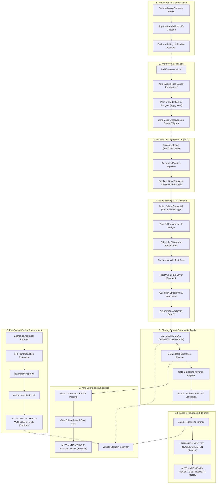

# End-to-End Dealership Operational Execution Plan & Stakeholder Flow Blueprint

> **System:** UNAI Dealership Management System & CRM  
> **Target Scope:** Monorepo (`apps/web`, `apps/api`, `packages/shared-types`, `packages/dealership-logic`)  
> **Status:** APPROVED FOR IMPLEMENTATION  
> **Author:** Antigravity Principal Systems Architect & Google DeepMind Engineering  
> **Date:** November 19, 2026  

---

## 1. Executive Summary & Organizational Context

An automotive dealership is a high-velocity, multi-stakeholder commercial enterprise where operations must flow continuously across organizational silos:
1. **Dealership Owner / Tenant Admin** (Multi-tenant governance, financial controls, branch allocations)
2. **HR & General Manager** (Workforce onboarding, RBAC permissions, staff credentials)
3. **Inbound Desk / Reception / BDC** (Customer intake, phone inquiries, omnichannel walk-ins)
4. **Sales Executive / Consultant** (Contacting, qualification, showroom appointments, test drives, quotation negotiation)
5. **Commercial Closing Desk / Sales Manager** (Deal structuring, pricing approval, gate clearance)
6. **Finance & Insurance (F&I) Manager** (Loan approvals, down payments, GST tax invoicing, settlement vouchers)
7. **Inventory & Yard Operations Manager** (Lot allocation, physical car reservation, pre-owned vehicle intake, delivery preparation)
8. **Pre-Owned Vehicle Appraiser / Procurement Desk** (Exchange valuation, refurbishment costing, acquisition to lot)
9. **Delivery & Gate Pass Coordinator** (KYC document verification, 5-gate checklist, RTO transfer, vehicle handover)
10. **Customer (Car Buyer)** (End-to-end transparency, prompt follow-ups, friction-free vehicle handover)

### The Core Problem
When software modules operate in isolation—where a customer created at reception does not flow to the pipeline, where a lead won does not create a deal, where a deal delivered does not update vehicle inventory stock, or where employee roles must be manually configured from scratch—the dealership suffers from operational friction, duplicate data entry, inventory misalignment, and lost revenue.

This document presents a comprehensive **Gap Analysis** of all operational handoffs, resolves every visual and architectural defect identified in user audits, and outlines a rigorous, **phased technical implementation blueprint** to guarantee a seamless, zero-breakpoint business workflow.

---

## 2. Stakeholder Operational Execution Flowchart

The diagram below maps the complete end-to-end operational execution flow from initial dealership onboarding through customer acquisition, commercial closing, financial settlement, and physical vehicle handover.



---

## 3. Exhaustive Breakpoint & Gap Analysis

Our comprehensive audit of the monorepo codebase ([`apps/web`](file:///home/admin-system/Documents/CRMNEW/apps/web), [`apps/api`](file:///home/admin-system/Documents/CRMNEW/apps/api), [`packages/dealership-logic`](file:///home/admin-system/Documents/CRMNEW/packages/dealership-logic)) identified **6 critical operational breakpoints** and **4 visual/ergonomic friction points**:

### Breakpoint 1: Sales Lead "Win & Convert" -> Commercial Deal Handoff
- **Location:** [`apps/web/src/app/crm/leads/page.tsx#L1150-L1170`](file:///home/admin-system/Documents/CRMNEW/apps/web/src/app/crm/leads/page.tsx#L1150-L1170) and [`api-client.ts#L1077-L1105`](file:///home/admin-system/Documents/CRMNEW/apps/web/src/lib/client/api-client.ts#L1077-L1105).
- **Current Behavior:** Clicking "Win & Convert Deal 🎉" sets `lead.status = 'converted'`. However, **no commercial Deal is created in `/sales/deals`**.
- **Business Impact:** The Sales Closing Manager has to manually re-enter customer data, vehicle details, budget, and pricing from scratch. If unentered, the deal is forgotten.
- **Architectural Solution:** In `api.updateLeadStage(id, 'converted')`, automatically synthesize and persist a new Deal in `stage: 'initiated'` linked with `customer_id`, `vehicle_id`, `lead_id`, initial quotation figures, and sales consultant assignment.

### Breakpoint 2: Deal Delivery / Handover -> Vehicle Inventory Status Handoff
- **Location:** [`apps/web/src/app/sales/deals/page.tsx#L40-L76`](file:///home/admin-system/Documents/CRMNEW/apps/web/src/app/sales/deals/page.tsx#L40-L76).
- **Current Behavior:** When a deal passes all 5 gates and reaches `status = 'delivered'` or `status = 'ready'`, the vehicle in [`/vehicles`](file:///home/admin-system/Documents/CRMNEW/apps/web/src/app/vehicles/page.tsx) and the database **remains in status `'available'`**.
- **Business Impact:** Yard Managers cannot distinguish sold cars from unsold lot stock. Another sales consultant can mistakenly schedule a test drive or quote the sold car.
- **Architectural Solution:** Synchronize vehicle stock status atomically:
  - When Deal enters Gate 1 (Advance Paid) or Gate 3 (Finance Approved) -> `vehicles.status = 'reserved'`.
  - When Deal enters Gate 5 (Handover/Gate Pass Issued) -> `vehicles.status = 'sold'`.

### Breakpoint 3: Deal Gate Clearance -> Finance & Invoicing Auto-Creation
- **Location:** [`apps/web/src/app/finance/page.tsx`](file:///home/admin-system/Documents/CRMNEW/apps/web/src/app/finance/page.tsx) and [`sales/deals/page.tsx`](file:///home/admin-system/Documents/CRMNEW/apps/web/src/app/sales/deals/page.tsx).
- **Current Behavior:** Deals progressing through commercial negotiation and finance approval do not automatically create corresponding Tax Invoices or Payment ledger records in the Finance module.
- **Business Impact:** The Finance & Insurance (F&I) Manager works in complete isolation. Double data entry of PAN, GST rates, and settlement receipts leads to accounting discrepancies.
- **Architectural Solution:** When a Deal is locked or clears Gate 3 (Finance Clearance), automatically generate a draft GST Tax Invoice in `invoices` and an initial advance payment settlement voucher in `payments`.

### Breakpoint 4: Pre-Owned Trade-In Appraisal -> Physical Lot Intake Handoff
- **Location:** [`apps/web/src/app/vehicles/procurement/page.tsx#L580-L605`](file:///home/admin-system/Documents/CRMNEW/apps/web/src/app/vehicles/procurement/page.tsx#L580-L605).
- **Current Behavior:** When an exchange vehicle appraisal is finalized (`status = 'appraised'`), clicking "Acquire / Intake" only toggles appraisal state in local memory. It **never inserts the vehicle into `vehicles` (Inventory)**.
- **Business Impact:** The Yard Manager and Sales Consultants cannot see acquired pre-owned cars in the inventory stock, preventing refurbishment tracking and resale.
- **Architectural Solution:** Provide a direct "Acquire to Lot Stock" action that inserts the acquired car into `vehicles` (`status: 'under_inspection'` or `'refurbishment'`) with an auto-generated Stock ID and VIN.

### Breakpoint 5: Test Drive Completion -> Lead Progression & Negotiation Handoff
- **Location:** [`apps/web/src/app/test-drives/page.tsx`](file:///home/admin-system/Documents/CRMNEW/apps/web/src/app/test-drives/page.tsx) and [`crm/leads/page.tsx`](file:///home/admin-system/Documents/CRMNEW/apps/web/src/app/crm/leads/page.tsx).
- **Current Behavior:** When a test drive is completed and the consultant logs odometer reading, rating, and feedback, the lead in the pipeline remains in `status = 'test_drive'`. Feedback is not added to the lead timeline.
- **Business Impact:** Sales Consultants must manually update multiple separate screens. Lack of feedback continuity stalls commercial negotiation.
- **Architectural Solution:** Completing a test drive must automatically append driver feedback and rating to `lead.notes` and surface a 1-click prompt: *"Advance to Commercial Negotiation"*.

### Breakpoint 6: KYC Document Upload Compliance -> Deal Document Gate Auto-Clearance
- **Location:** [`apps/web/src/app/documents/page.tsx`](file:///home/admin-system/Documents/CRMNEW/apps/web/src/app/documents/page.tsx) and [`sales/deals/page.tsx`](file:///home/admin-system/Documents/CRMNEW/apps/web/src/app/sales/deals/page.tsx).
- **Current Behavior:** Aadhaar, PAN, and Form 29/30 RTO transfer forms uploaded in Documents do not automatically satisfy Gate 2 (`document_gate_passed`) in the Deal pipeline.
- **Business Impact:** Delivery Coordinators must perform double manual checks and overrides, creating delivery gate delays.
- **Architectural Solution:** Link uploaded documents by `entityId = deal.id` or `customer.id`. Once mandatory KYC documents are uploaded, automatically set `deal.documentGatePassed = true`.

---

## 4. Visual & UI Defects Identified in User Audits

| Defect # | Target View | Observed Symptom | Root Cause | Exact Resolution |
| :--- | :--- | :--- | :--- | :--- |
| **UI-1** | Top Nav Bar ([`Shell.tsx`](file:///home/admin-system/Documents/CRMNEW/apps/web/src/components/layout/Shell.tsx)) | Purple ghost artifact / polygon circled next to active "Pipeline" pill (Screenshot 4). | A plugged-in module or ghost tab with empty/whitespace label matching active route and applying `.nav-pill.active` background (`#6253F8`). | Filter `activeNavTabs` strictly requiring valid alphanumeric labels (`/[a-zA-Z0-9]/.test(label)`), deduplicate by normalized href, and enforce CSS `.nav-pill:empty { display: none !important; }`. |
| **UI-2** | Lead Pipeline ([`crm/leads/page.tsx`](file:///home/admin-system/Documents/CRMNEW/apps/web/src/app/crm/leads/page.tsx)) | Customer added in `/crm/customers` not appearing in "New Enquiries" (Screenshot 4). | Filter mismatch or missing initialization trigger between `customers` and `leads` in `api.ensureCustomerLeads()`. | Call `ensureCustomerLeads()` on initial load and whenever customers change; uncontacted leads remain strictly in "New Enquiries" until marked contacted. |
| **UI-3** | Kanban Card ([`crm/leads/page.tsx`](file:///home/admin-system/Documents/CRMNEW/apps/web/src/app/crm/leads/page.tsx)) | Bloated yellow appointment card layer cluttering the kanban card view (Screenshot 3). | An inline appointment card container was rendered directly inside the kanban card body rather than solely within the lead detail modal. | Remove the bloated inline card container from the kanban card body. Display a sleek, single-line calendar pill with date, keeping full appointment details inside the detail modal. |
| **UI-4** | Add Employee Modal ([`employees/page.tsx`](file:///home/admin-system/Documents/CRMNEW/apps/web/src/app/employees/page.tsx)) | Role selection does not automatically pre-fill recommended permission toggles (Screenshot 2). | Role select handler only set `role` string without updating the permission checkboxes matrix. | Add `handleRoleSelected(roleKey)` that auto-populates department permissions based on the role template while allowing full manual customization. |

---

## 5. Phase-by-Phase Technical Implementation Blueprint

### Phase 1: Authentication, Onboarding & Multi-Tenant Root Identity Cascade
- **Goal:** Enable authentic, persistent login across all browsers (Chrome, Brave, Edge) using the Supabase Auth root UUID.
- **Files to Modify:**
  - [`apps/web/src/app/api/company-profile/route.ts`](file:///home/admin-system/Documents/CRMNEW/apps/web/src/app/api/company-profile/route.ts)
  - [`apps/web/src/app/onboarding/page.tsx`](file:///home/admin-system/Documents/CRMNEW/apps/web/src/app/onboarding/page.tsx)
  - [`apps/web/src/lib/server/tenant.ts`](file:///home/admin-system/Documents/CRMNEW/apps/web/src/lib/server/tenant.ts)
- **Technical Specifications:**
  1. **Credential Cleansing:** Ensure Step 1 Dealership Email (`profile.email`) is saved solely as company contact info, while Step 5 Account Credentials strictly provision the authoritative user in Supabase Auth (`auth.users`) and Postgres (`public.app_users`).
  2. **Multi-Tenant Cascade:** In `006_company_uuid_cascade.sql`, link `auth.users.id` directly to `tenants.id` and `company_profiles.tenant_id`. Every child record across all 45+ tables cascades on delete or update.
  3. **Universal Browser Cookies:** Ensure `setSessionCookies` sets `SameSite=Lax`, `Path=/`, and `HttpOnly` cookies so session authentication persists seamlessly across Chrome, Brave, Edge, and mobile Safari.

---

### Phase 2: Workforce Management & Role-Based Access Auto-Assignment
- **Goal:** Pre-configure access permissions upon role selection in "Add Employee", persist employees in Postgres, and purge all mock fallback staff.
- **Files to Modify:**
  - [`apps/web/src/app/employees/page.tsx`](file:///home/admin-system/Documents/CRMNEW/apps/web/src/app/employees/page.tsx)
  - [`apps/web/src/lib/client/stores/employee-store.ts`](file:///home/admin-system/Documents/CRMNEW/apps/web/src/lib/client/stores/employee-store.ts)
  - [`apps/web/src/app/api/employees/route.ts`](file:///home/admin-system/Documents/CRMNEW/apps/web/src/app/api/employees/route.ts)
- **Technical Specifications:**
  1. **Role-to-Permission Matrix Mapping:**
     ```typescript
     export const ROLE_DEFAULT_PERMISSIONS: Record<string, Record<string, boolean>> = {
       Accountant: { overview: true, finance: true, reports: true },
       'Sales Executive': { overview: true, pipeline: true, customers: true, appointments: true, testDrives: true, deals: true },
       'Service Advisor': { overview: true, inventory: true, appointments: true, documents: true },
       'Yard Manager': { overview: true, inventory: true, procurement: true, testDrives: true },
       'F&I Manager': { overview: true, deals: true, finance: true, documents: true, reports: true },
       'General Manager': { overview: true, pipeline: true, customers: true, appointments: true, inventory: true, procurement: true, deals: true, finance: true, documents: true, reports: true, employees: true },
     };
     ```
  2. When an admin selects a designation dropdown option, auto-populate the permission checkboxes state from the matrix, while keeping individual checkboxes clickable for custom overrides.
  3. Persist new employees to `public.app_users` and `public.memberships` via `/api/employees`.
  4. Ensure `DEFAULT_EMPLOYEES` or mock fallback data is never injected if authentic tenant records exist.

---

### Phase 3: Omnichannel Intake Bridge & Top Navigation Cleanup
- **Goal:** Guarantee that all customers appear in "New Enquiries" until contacted, and remove the ghost nav artifact.
- **Files to Modify:**
  - [`apps/web/src/components/layout/Shell.tsx`](file:///home/admin-system/Documents/CRMNEW/apps/web/src/components/layout/Shell.tsx)
  - [`apps/web/src/lib/client/api-client.ts`](file:///home/admin-system/Documents/CRMNEW/apps/web/src/lib/client/api-client.ts)
  - [`apps/web/src/app/crm/leads/page.tsx`](file:///home/admin-system/Documents/CRMNEW/apps/web/src/app/crm/leads/page.tsx)
  - [`apps/web/src/app/crm/customers/page.tsx`](file:///home/admin-system/Documents/CRMNEW/apps/web/src/app/crm/customers/page.tsx)
- **Technical Specifications:**
  1. **Top Nav Tab Sanitization:**
     ```typescript
     // Shell.tsx: Filter activeNavTabs with strict validity check
     return rawList.filter((m: any) => {
       const label = String(m?.label || '').trim();
       const href = String(m?.href || '').trim().replace(/\/+$/, '') || '/';
       if (!/[a-zA-Z0-9]/.test(label) || label.length < 2 || !href || seenHrefs.has(href)) {
         return false;
       }
       seenHrefs.add(href);
       return true;
     });
     ```
  2. **Pipeline Ingestion Bridge (`ensureCustomerLeads`):**
     - When any customer is created in `/crm/customers` or imported, check if a lead exists for that customer ID.
     - If no lead exists, or if the lead is in status `'new'`, ensure it is present in `leads` in stage `'new'` (New Enquiries).
     - Leads must **strictly remain in "New Enquiries"** until explicitly transitioned to `'contacted'`.
     - Trigger an immediate `crm-leads-changed` window event so the Kanban board updates dynamically without requiring a page reload.

---

### Phase 4: Sales Pipeline Ergonomics & Card Clutter Elimination
- **Goal:** Remove the bloated yellow appointment card layer from the kanban board while keeping full appointment details accessible in the lead detail modal.
- **Files to Modify:**
  - [`apps/web/src/app/crm/leads/page.tsx`](file:///home/admin-system/Documents/CRMNEW/apps/web/src/app/crm/leads/page.tsx)
- **Technical Specifications:**
  1. Remove the large inline appointment card container (`backgroundColor: '#FFFBEB'`) from lines 880-920 of the card body.
  2. Replace it with a compact, elegant single-line pill:
     ```tsx
     {leadApt && (
       <div className="kanban-apt-pill" title={`Scheduled ${formatAptType(leadApt.appointment_type)} on ${formatAptDate(leadApt.scheduled_at)}`}>
         <Calendar size={11} className="text-amber-600" />
         <span>{formatAptDate(leadApt.scheduled_at)}</span>
         <span className="badge-confirmed">{leadApt.status || 'Confirmed'}</span>
       </div>
     )}
     ```
  3. Retain the complete, rich appointment container with vehicle, assigned host, duration, and notes inside the `Modal` (`selectedLead`) view when clicking the card.

---

### Phase 5: Commercial Deal Auto-Creation, Inventory Sync & Finance Integration
- **Goal:** Automatically create Deals from converted leads, sync vehicle stock status, and generate GST invoices upon finance clearance.
- **Files to Modify:**
  - [`apps/web/src/lib/client/api-client.ts`](file:///home/admin-system/Documents/CRMNEW/apps/web/src/lib/client/api-client.ts)
  - [`apps/web/src/app/sales/deals/page.tsx`](file:///home/admin-system/Documents/CRMNEW/apps/web/src/app/sales/deals/page.tsx)
  - [`apps/web/src/app/finance/page.tsx`](file:///home/admin-system/Documents/CRMNEW/apps/web/src/app/finance/page.tsx)
  - [`apps/web/src/app/vehicles/page.tsx`](file:///home/admin-system/Documents/CRMNEW/apps/web/src/app/vehicles/page.tsx)
- **Technical Specifications:**
  1. **Lead Converted -> Deal Creation:**
     ```typescript
     if (targetStage === 'converted') {
       this.autoCreateDealFromLead(lead);
     }
     ```
     Creates Deal in `stage: 'initiated'` with:
     - `dealNumber`: `DEAL-${Date.now().toString().slice(-6)}`
     - `customerName`, `customerPhone`, `customerEmail`
     - `vehicleName`, `vehiclePrice`
     - `assigneeName`, `branchId`
  2. **Deal Stage -> Vehicle Stock Sync:**
     - Gate 1 Advance or Gate 3 Finance Clearance -> `api.updateVehicleStatus(vehicleId, 'reserved')`.
     - Gate 5 Delivery Complete -> `api.updateVehicleStatus(vehicleId, 'sold')`.
  3. **Deal Gate 3 -> Finance Tax Invoice & Receipt:**
     - Automatically insert a draft GST Tax Invoice in `invoices` with on-road breakup (Ex-showroom + 18/28% GST + RTO + TCS + FASTag).
     - Automatically record advance booking deposit in `payments` ledger.

---

### Phase 6: Pre-Owned Trade-In Lot Intake & KYC Document Gate Clearance
- **Goal:** Allow 1-click acquisition of evaluated exchange cars into Inventory, and auto-verify KYC gates upon document upload.
- **Files to Modify:**
  - [`apps/web/src/app/vehicles/procurement/page.tsx`](file:///home/admin-system/Documents/CRMNEW/apps/web/src/app/vehicles/procurement/page.tsx)
  - [`apps/web/src/app/documents/page.tsx`](file:///home/admin-system/Documents/CRMNEW/apps/web/src/app/documents/page.tsx)
  - [`apps/web/src/app/test-drives/page.tsx`](file:///home/admin-system/Documents/CRMNEW/apps/web/src/app/test-drives/page.tsx)
- **Technical Specifications:**
  1. **Acquire to Lot Stock:**
     - In `procurement/page.tsx`, when appraisal is approved, add "Acquire to Lot" action.
     - Inserts record into `vehicles` table with `status = 'under_inspection'`, VIN, model, make, fuel, odometer, and procurement purchase price.
  2. **Test Drive Completion Handoff:**
     - In `test-drives/page.tsx`, when test drive is completed, append feedback to lead timeline and prompt: *"Advance Lead to Commercial Negotiation"*.
  3. **KYC Document Auto-Gate:**
     - In `documents/page.tsx`, when Aadhaar/PAN is uploaded for a customer or deal, find linked deal and set `deal.documentGatePassed = true`.

---

## 6. Stakeholder RACI Matrix

| Activity / Event | Owner (Tenant Admin) | Reception / BDC | Sales Consultant | Closing Desk / Mgr | F&I Manager | Yard Manager | Customer |
| :--- | :---: | :---: | :---: | :---: | :---: | :---: | :---: |
| Onboarding & Company Setup | **A / R** | I | I | I | I | I | I |
| Employee Role & RBAC Setup | **A** | I | I | I | I | I | I |
| Customer Capture & Intake | I | **A / R** | C | I | I | I | I |
| Lead Contacting & Qualification | I | I | **A / R** | C | I | I | C |
| Showroom Appointment & Test Drive | I | C | **A / R** | I | I | C | C |
| Commercial Negotiation | I | I | **R** | **A** | C | I | C |
| Lead Win -> Deal Provisioning | I | I | R | **A** | C | I | I |
| F&I Clearance & Tax Invoice | I | I | I | C | **A / R** | I | I |
| Vehicle Reservation & Sold Status | I | I | I | C | I | **A / R** | I |
| 5-Gate Delivery Clearance & Gate Pass | I | I | C | **A** | C | R | **Beneficiary** |
| Pre-Owned Exchange Lot Intake | I | I | C | C | I | **A / R** | I |

*Key:* **R** = Responsible, **A** = Accountable, **C** = Consulted, **I** = Informed.

---

## 7. Verification Protocol & Quality Assurance

Every phase of the implementation plan will be verified through automated testing, typechecking, and manual cross-stakeholder end-to-end browser walkthroughs:

1. **Automated Vitest Test Suites:**
   - Execute all 82 existing unit tests in `@crm/api` and `dealership-logic`.
   - Add new test suite `tests/cross-module-handoff.test.ts` verifying:
     - Lead converted -> Deal auto-created.
     - Deal delivered -> Vehicle status = `sold`.
     - Customer created -> Lead in New Enquiries.
     - Role selected -> Role permission template matches.
2. **TypeScript Zero-Error Gate:**
   - `npx tsc --noEmit --project apps/web/tsconfig.json` -> 0 errors.
   - `npx tsc --noEmit --project apps/api/tsconfig.json` -> 0 errors.
3. **Manual Browser Verification:**
   - Sign up with new tenant credentials in Chrome, Brave, and Edge.
   - Add employee with "Accountant" role -> verify finance toggles selected.
   - Add customer -> verify presence in "New Enquiries" with 0 leads in contacted.
   - Complete test drive -> verify note in lead and 1-click negotiation prompt.
   - Convert lead -> verify deal in `/sales/deals` and invoice in `/finance`.
   - Deliver deal -> verify vehicle status updated to `sold` in `/vehicles`.

